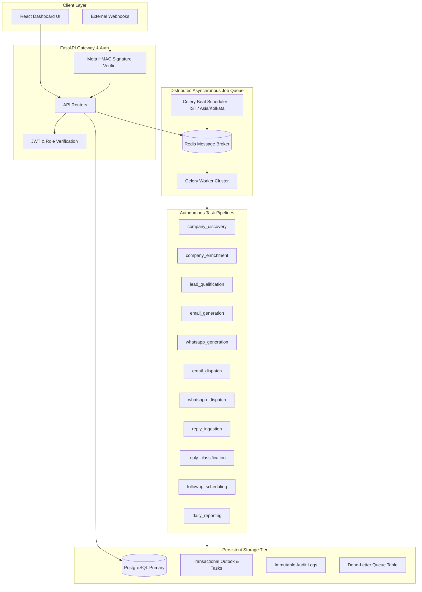

# ActTrident AI Outreach Agent — Autonomous Automation Architecture

**Date:** 2026-11-14  
**Architect:** Principal Automation Architect & AI Systems Engineer  

---

## 1. Architectural Overview

The Autonomous Automation Engine transforms the ActTrident platform from a synchronous request-driven tool into a distributed, event-driven, resilient B2B sales automation engine.

---

## 2. Core Automation Components

### 2.1 Job Execution Engine: Celery + Redis
- **Message Broker**: Redis 7.x running on isolated internal network.
- **Worker Concurrency**: Gevent/pre-fork worker pool partitioned by queue priority:
  - `high_priority`: Webhook processing, reply classification, approval notifications.
  - `outreach`: Email dispatch, WhatsApp Cloud API dispatch, rate limiters.
  - `research`: Website scraping, SSRF-validated crawling, LLM enrichment.
  - `background`: Nightly company discovery, database maintenance, stale evidence verification.

### 2.2 Task Categories & Specifications

1. `company_discovery`: Ingests company leads from permitted business directories, search engines, and CSV uploads.
2. `company_enrichment`: Crawls verified corporate websites, retrieves MCA filings, extracts public business contacts.
3. `website_research`: Deep analysis of tech stack, remote workforce evidence, and browser workflow dependencies.
4. `lead_qualification`: Computes 7-factor qualification scores; flags 5+ laptop fleets with documented source attribution.
5. `email_generation`: Constructs 8-part personalized email drafts in 5 distinct tones.
6. `whatsapp_generation`: Prepares WhatsApp drafts using pre-approved Meta templates; checks documented consent.
7. `email_dispatch`: Dispatches approved emails via Gmail API OAuth2 or authenticated SMTP with backoff and rate limits.
8. `whatsapp_dispatch`: Sends approved WhatsApp template messages via official Meta Cloud API.
9. `reply_ingestion`: Ingests inbound email threads and WhatsApp webhook delivery receipts idempotently.
10. `reply_classification`: Classifies inbound sentiment into 10 categories and drafts suggested follow-ups.
11. `crm_update`: Transitions lead states across 16 pipeline stages and synchronizes timestamps.
12. `followup_scheduling`: Autonomous multi-touch follow-up scheduler respecting business day intervals and stop triggers.
13. `daily_reporting`: Compiles operational metrics, sending volume, approval backlog, and sends daily digest to managers.

---

## 3. Reliability, Resilience & Rate Limiting

### 3.1 Idempotency & Dead-Letter Queue (DLQ)
- Every dispatch task generates a deterministic idempotency key:  
  `idempotency_key = sha256(recipient + campaign_id + step_number + date)`
- Redis keys with 24-hour TTL prevent duplicate dispatch attempts.
- Failed tasks after 3 exponential backoff retries (`retry_backoff=True, retry_jitter=True`) are committed to a `dead_letter_tasks` database table for administrative inspection.

### 3.2 Tiered Rate Limiters
- **Provider-Level Rate Limits**:
  - Meta WhatsApp Cloud API: 80 messages / sec maximum (conservative default: 10 msg/min).
  - Gmail API: 250 quota units / user / sec (conservative default: 30 emails/min).
- **Campaign-Level Limits**: Respects campaign `daily_email_limit` and `daily_whatsapp_limit`.
- **Global Limits**: Configurable global safety ceiling enforced via Redis token bucket.

### 3.3 Timezone-Aware Scheduling
- All outreach tasks run strictly within business hours (09:30 - 18:30 IST) according to the `Asia/Kolkata` timezone.
- No outbound messages are dispatched on national holidays or weekends without explicit managerial override.
