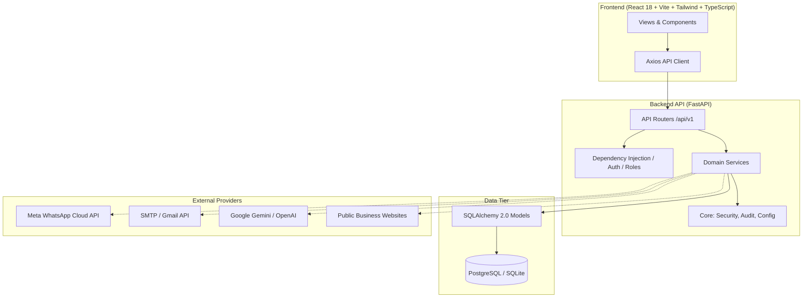

# ActTrident AI Outreach Agent — Comprehensive Codebase Audit

**Date:** 2026-11-14  
**Auditor:** Principal AI Engineer & Automation Architect  
**Branch:** `feature/autonomous-automation`  
**Repository:** `https://github.com/shubham99557/message-agent`  

---

## 1. Executive Summary

A comprehensive audit was performed on the ActTrident AI Outreach Agent platform covering backend APIs, database models, frontend interfaces, security mechanisms, test suites, and third-party integrations.

The existing application provides an enterprise-ready foundation with **13 frontend views**, **13 REST API routers**, **22 database models**, and **21 passing unit tests**. However, the audit identified critical security gaps, simulated integrations, architectural bottlenecks (synchronous in-band execution without distributed job queues), and absent follow-up automation.

---

## 2. Inventory & Inspection of Codebase Modules

### 2.1 Backend Modules (`backend/app/`)

| Module | Purpose | Status / Findings |
| :--- | :--- | :--- |
| `core/config.py` | Environment & settings | **Vulnerable**: Hardcoded fallback JWT secret; 7-day access token lifetime; wildcard CORS `["*"]`; missing `META_APP_SECRET`. |
| `core/database.py` | SQLAlchemy engine & session | Functional SQLite/PostgreSQL support with connection pooling. |
| `core/security.py` | Password hashing, JWT, SSRF guard, Prompt injection sanitizer | Functional bcrypt & JWT. SSRF checks private IP ranges. Regex prompt sanitizer active. Missing HMAC-SHA256 signature verifier and content hashing. |
| `core/audit.py` | Compliance audit logging | Functional audit logging table. |
| `models/` (22 models) | ORM entities | Well-structured relationships. Gaps: Missing `is_demo`, missing `content_hash`/`version` on messages, missing `created_by_id` on campaigns/companies, missing `RefreshToken` model, missing `WebhookEvent` idempotency model. |
| `schemas/` | Pydantic validation schemas | High coverage. `UserCreate` vulnerability: accepts arbitrary `role` from unauthenticated client. |
| `api/deps.py` | JWT authentication and role dependencies | Role dependency `require_role` implemented but not applied across approval, campaign, or webhook endpoints. |
| `api/endpoints/auth.py` | Registration, login, profile | **Critical**: Unrestricted role assignment on `/register`; auto-seeds hardcoded admin credentials on login. |
| `api/endpoints/companies.py` | CRUD, CSV import, sources | Functional, but lacks ownership checks and `is_demo` segmentation. |
| `api/endpoints/discovery.py` | Company search | **Simulated**: Queries hardcoded in-memory catalog instead of live search/directory APIs. |
| `api/endpoints/qualification.py`| 7-factor AI qualification | Implements 7 factors with score breakdown. Lacks automated re-verification for stale records. |
| `api/endpoints/research.py` | AI research generation | Safe SSRF-protected web fetcher + AI/rule engine. Functional guardrails against inventing cyberattacks. |
| `api/endpoints/emails.py` | Email draft generation & sending | Functional 5 tones and 8-part structure. Lacks message content hashing on edits. |
| `api/endpoints/approvals.py` | Approval queue management | **Critical**: Editing an approved draft does not invalidate approval; missing role restriction (`sales_rep` can approve); missing content hash check. |
| `api/endpoints/campaigns.py` | Campaign orchestration | Basic batching. Lacks background job queue (synchronous execution blocks HTTP requests). |
| `api/endpoints/whatsapp.py` | Meta Cloud API & Webhooks | **Critical**: Webhook endpoint `/webhook` accepts unverified POST requests without HMAC signature; missing idempotency. |
| `api/endpoints/replies.py` | Reply ingestion & classification | **Critical**: `/inbound` endpoint is unauthenticated, allowing arbitrary reply injection. |
| `api/endpoints/crm.py` | Sales pipeline management | Functional 16-stage pipeline and opt-out suppression. Lacks autonomous follow-up scheduler. |
| `api/endpoints/analytics.py` | Metrics & conversion rates | Correct mathematical denominators. Gaps: Counts mock-sent messages in metrics. |
| `api/endpoints/settings.py` | System settings | Basic credential test stubs. |

---

### 2.2 Frontend Modules (`frontend/src/`)

| View / Component | Purpose | Current State |
| :--- | :--- | :--- |
| `App.tsx` | App shell, navigation & routing | Executive Cobalt layout; handles active view switching; token storage in `localStorage`. |
| `api/client.ts` | Axios HTTP client & interceptors | Attached Bearer token on requests; handles 401 redirect. Needs refresh token rotation. |
| `views/DashboardView.tsx` | Overview, metrics, shortcuts | Functional stats and recent activity feed. |
| `views/DiscoveryView.tsx` | Search interface for target cities | Functional UI; currently backed by simulated catalog. |
| `views/LeadsView.tsx` | Lead database & filters | Functional table with qualification badges and source links. |
| `views/ResearchView.tsx` | AI research reports | Detailed display of tech requirements and safe use cases. |
| `views/EmailOutreachView.tsx` | Draft generator (5 tones) | Interactive tone selector and preview. |
| `views/WhatsAppView.tsx` | Meta templates & click-to-chat | Enforces consent status badge; displays click-to-chat fallback link. |
| `views/ApprovalQueueView.tsx` | Human approval queue | Displays source attribution and consent before approving. |
| `views/CampaignsView.tsx` | Campaign manager | Campaign creation and recipient association. Lacks background queue health. |
| `views/InboxView.tsx` | Unified reply triage | Displays AI classification and suggested replies. |
| `views/CrmPipelineView.tsx` | Kanban / Stage manager | 16 pipeline stages with drag/select stage transitions and follow-up logging. |
| `views/AnalyticsView.tsx` | Funnel & Conversion graphs | Real conversion denominators and stage distribution. |
| `views/IntegrationsView.tsx` | Provider configuration | Config UI for Gemini, OpenAI, Gmail, SMTP, WhatsApp. |
| `views/SettingsView.tsx` | Limits & team accounts | Daily limits and team user listing. |

---

## 3. Simulated vs. Genuinely Working Integrations

| Integration | Genuinely Working? | Evidence / Root Cause |
| :--- | :--- | :--- |
| **Bcrypt & JWT Auth** | **Yes** | Standard RFC 7519 JWT verification and bcrypt password hashing. |
| **SQLAlchemy 2.0 ORM** | **Yes** | Fully verified with SQLite and PostgreSQL compatibility. |
| **SSRF Web Fetcher** | **Yes** | Blocks loopback, private RFC 1918 IPs, and cloud metadata endpoints. |
| **Prompt Injection Filter** | **Yes** | Filters override patterns (`ignore all previous instructions`). |
| **Gemini / OpenAI API** | **Conditional** | Works if valid API key is present in environment; falls back to deterministic rule engine when keys are absent. |
| **Company Discovery** | **Simulated** | Returns static `DISCOVERY_CATALOG` array; does not query live external search or directory APIs. |
| **Email Transport (SMTP)** | **Conditional** | Genuinely connects to SMTP server if host/credentials provided; if not, simulates success and logs false `delivered` event. |
| **Gmail API OAuth 2.0** | **Simulated** | Documentation guide exists (`docs/GMAIL_INTEGRATION_GUIDE.md`), but backend has no OAuth2 token exchange or refresh flow. |
| **WhatsApp Cloud API** | **Conditional** | Makes real HTTP POST to `graph.facebook.com` if token and phone ID exist; falls back to mock delivery if unset. |
| **Meta Webhook Signature** | **Simulated** | Returns `200 received` without checking `X-Hub-Signature-256` HMAC. |
| **Background Processing** | **Non-existent** | No Redis or Celery; tasks execute synchronously in FastAPI thread, risking timeouts. |
| **Follow-up Engine** | **Manual only** | Pipeline tracks follow-ups, but no scheduled cron/beat exists to trigger follow-up outreach. |

---

## 4. Test Suite Analysis

- Current test coverage: **21 unit/integration tests** (`backend/tests/`).
- Strengths:
  - 100% passing tests for qualification factors, laptop count verification, opt-out suppression, and analytics conversion math.
- Gaps:
  - No security tests for privilege escalation via registration.
  - No tests for JWT token tampering or expiration.
  - No tests for webhook signature forgery.
  - No tests for draft tampering post-approval.
  - No tests for concurrent job execution or distributed queue failures.

---

## 5. Dependency Map

---

## 6. Actionable Recommendations

1. **Immediate (Stage 1)**: Remediate all 15 critical security vulnerabilities: eliminate role escalation, remove hardcoded admin credentials, add refresh token rotation, enforce role checks on approvals, implement content hashing, and verify webhook signatures.
2. **Architecture (Stage 2)**: Introduce Celery and Redis to decouple outbound sending, AI research, and follow-ups from the HTTP request cycle.
3. **Integrations (Stages 3-7)**: Implement genuine search/directory adapters, real Gmail API OAuth2, and authenticated Meta Cloud API webhooks.
4. **Automation (Stages 8-11)**: Deploy scheduled multi-stage follow-up workflows and unified inbox triage.
