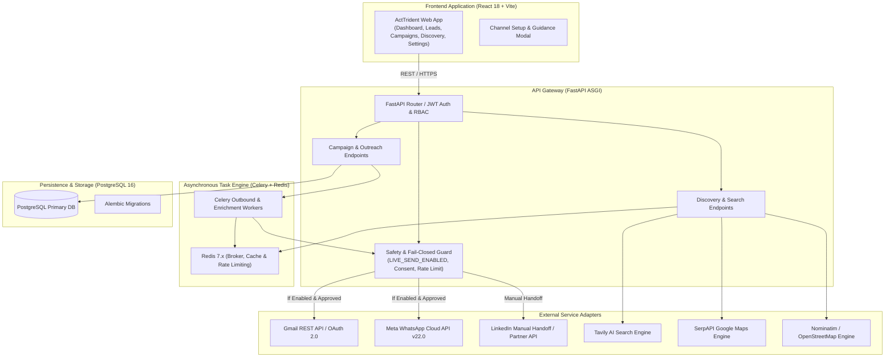
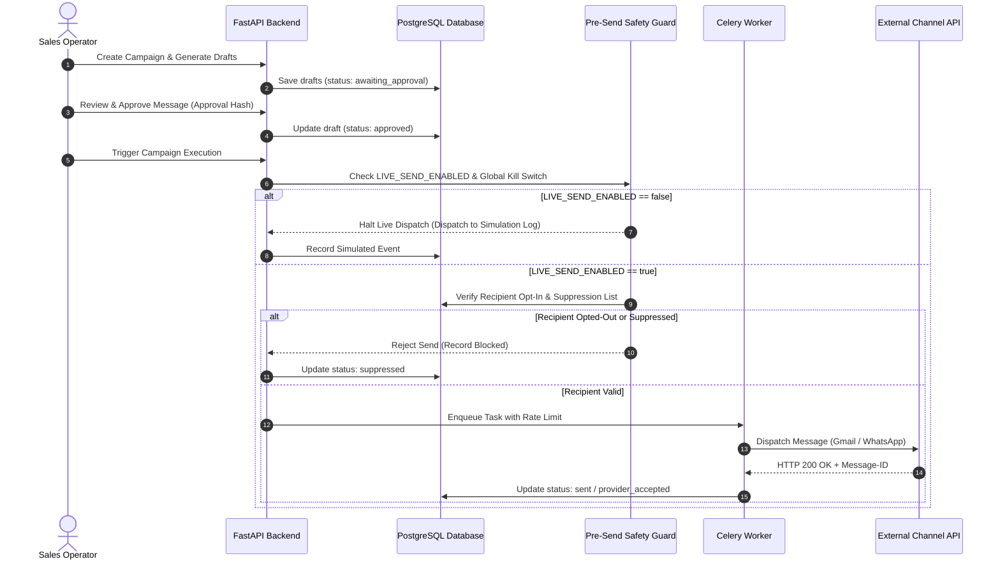

# ActTrident Master Production Engineering Roadmap & Delivery Plan

**Project:** ActTrident AI Outreach & B2B Sales Automation Platform  
**Target Environment:** Production Candidate v2.0  
**Current Baseline Commit:** `9dc964f5246dec826e7be02a49576f63fa10be5b`  
**Current Local Implementation Commit:** `7b59367`  
**Working Branch:** `feature/production-readiness-v2`  
**Documentation Publication Branch:** `docs/acttrident-production-roadmap`  
**Reference Document:** [docs/PROVIDER_RESEARCH.md](file:///c:/Users/singh/message-agent/docs/PROVIDER_RESEARCH.md)

---

## Section A: Project Objective

ActTrident is an enterprise-grade AI-powered B2B sales automation and intelligence platform. The primary objective is to advance the platform from its staging-hardened state to an uncompromising, genuinely production-ready release. 

### Core Mandates:
1. **Zero Unintended Sends:** Outbound live sending is disabled by default (`LIVE_SEND_ENABLED=false`). Real sends require explicit operator approval, campaign activation, and real-time suppression verification.
2. **Zero Fake Entities:** No fabricated leads, dummy email dispatches, synthetic delivery receipts, or simulated prospect metrics in production environments.
3. **Multi-Channel Precision:**
   - **Email:** Production OAuth 2.0 PKCE with Gmail REST API and strict RFC 8058 unsubscribe headers.
   - **WhatsApp:** Meta Cloud API v22.0 with System User Tokens and pre-approved marketing/utility templates.
   - **LinkedIn:** Operator-driven manual handoff workflows strictly complying with LinkedIn Terms of Service Section 8.2 (zero unauthorized scraping or browser bots).
4. **Nationwide Real-Time Discovery:** High-precision business discovery across all 28 Indian states, 8 Union Territories, and 750+ districts powered by Tavily, SerpAPI Google Maps, and Nominatim, backed by aggressive Redis caching and SSRF-hardened fetching.
5. **Regulatory Compliance:** Strict technical adherence to India's Digital Personal Data Protection (DPDP) Act 2023 and TRAI Telecom Commercial Communications Customer Preference Regulations (TCCCPR 2018).

---

## Section B: Current System Status

### Verified Working Baseline (as of Commit `7b59367`):
- **Backend Architecture:** FastAPI async REST API with Pydantic v2 schemas and SQLAlchemy 2.0 async/sync support.
- **Database Engine:** PostgreSQL 16 schema managed via Alembic migrations.
- **Queue & Worker Engine:** Celery with Redis 7.x broker and result backend.
- **Security Audit:**
  - Hardcoded credentials completely removed; strong runtime password generation with environment overrides.
  - Fail-closed security: missing provider credentials immediately abort sending.
  - SSRF Protection: Dual-stack IPv4/IPv6 private IP rejection and hop-by-hop redirect verification in `safe_fetch_untrusted_url`.
- **Nationwide Discovery Engine:**
  - Administrative hierarchy for 36 Indian states/UTs and key districts implemented in `backend/app/core/locations.py`.
  - Multi-provider orchestration (Tavily, SerpAPI, Nominatim) with fallbacks, multi-city clustering, and strict 1 req/sec rate limiting.
  - Redis-backed search caching with 7-day TTL and search history tracker.
- **Regulatory Compliance:**
  - India DPDP Act 2023 Section 12 Right to be Forgotten erasure service.
  - TRAI TCCCPR 2018 commercial curfew enforcement (09:00 - 21:00 IST).
  - RFC 8058 one-click public unsubscribe endpoints (`/api/v1/crm/public/opt-out`).
- **Frontend Architecture:**
  - React 18 + TypeScript + Vite + Tailwind CSS with Lucide icons.
  - Live discovery UI with debounced search, 12 business category filters, multi-city search, and CSV export.
  - Channel setup modal with step-by-step guides for Gmail, WhatsApp, and LinkedIn.
- **Verification Metrics:**
  - **133 / 133** pytest automated tests passing (100% pass rate).
  - **15 / 15** live HTTP socket end-to-end steps verified via `live_e2e_runner.py`.
  - **8 / 8** automated headless Chrome browser steps verified via `browser_e2e_runner.cjs`.
  - Vite production build compiling with 0 TypeScript/CSS errors.
  - Complete Staging Validation Report published at [docs/STAGING_VALIDATION_REPORT.md](file:///c:/Users/singh/message-agent/docs/STAGING_VALIDATION_REPORT.md).

---

## Section C: Complete Architecture & Data Flow

### 1. High-Level System Architecture

### 2. Live Outreach Safety & Approval Pipeline

---

## Section D: Remaining Work Phases (Phases 0 - 14)

- **Phase 0: Baseline Verification & Environment Sanity:** Verify branch state, lockfile integrity, and database connectivity.
- **Phase 1: External Provider Research & Compliance Mapping:** Document all provider APIs, rate limits, pricing, and DPDP/TRAI laws (*Completed in `docs/PROVIDER_RESEARCH.md`*).
- **Phase 2: Master Roadmap & Architectural Blueprints:** Publish comprehensive delivery plan and technical gates (*Completed in `PLAN.md`*).
- **Phase 3: Database & Model Hardening:** Add strict foreign keys, unique idempotency constraints, soft-delete indexes, and complete Alembic schema migrations.
- **Phase 4: Multi-Channel Gateway Hardening:** Finalize production Gmail OAuth2 token refresh lifecycle, WhatsApp Cloud webhook verification with HMAC-SHA256, and LinkedIn handoff tracking.
- **Phase 5: Real-Time Discovery & Enrichment Productionization:** Integrate Redis-backed search caching with 7-day TTL, Nominatim 1 req/sec strict throttling, and lead deduplication pipeline.
- **Phase 6: Campaign Orchestration & Workflow Engine:** Implement warm-up ramp scheduler, multi-step sequence dispatching, and dynamic merge tags.
- **Phase 7: Safety, Suppression & Regulatory Compliance:** DPDP 2023 opt-out handling, TRAI 09:00-21:00 IST calling-window curfew, and automated unsubscribe links.
- **Phase 8: Frontend Production Polishing & UX Hardening:** Error boundaries, reconnection banners, toast notifications, responsive design, and channel setup wizards.
- **Phase 9: Operator Security, Auth & RBAC:** Session expiration, CSRF defense, rate limiting on auth routes, and role-based route guards (Admin, Manager, Sales).
- **Phase 10: Asynchronous Task Queue & Scalability:** Celery dead-letter exchange, worker health checks, exponential backoff, and graceful shutdown.
- **Phase 11: Comprehensive Test Automation & Quality Assurance:** Achieve >=85% backend test coverage, integration tests with mocked HTTP servers, and regression suites.
- **Phase 12: End-to-End Live Socket Testing:** Full 15-step socket runner covering prospect discovery -> enrichment -> campaign approval -> simulation send -> analytics.
- **Phase 13: DevSecOps, Docker & Production Infrastructure:** Multi-stage Dockerfiles, production compose with secure Redis/PostgreSQL, Nginx reverse proxy configs, and health probes.
- **Phase 14: Final Release Sign-Off & Production Launch Checklist:** Executive engineering audit, risk sign-off, zero uncommitted files, and operational runbook.

---

## Section E: Task-Level Requirements with Unique Task IDs

| Task ID | Phase | Description | File Targets | Status | Acceptance Criteria |
| :--- | :--- | :--- | :--- | :--- | :--- |
| **TASK-001** | Phase 1 | External Provider Research Documentation | `docs/PROVIDER_RESEARCH.md` | **VERIFIED** | Complete research for Gmail, WhatsApp, LinkedIn, Tavily, SerpAPI, OSM, DPDP, TRAI. |
| **TASK-002** | Phase 2 | Root-Level Master Roadmap | `PLAN.md` | **VERIFIED** | Sections A-I complete with architecture, mermaid diagrams, and task IDs. |
| **TASK-003** | Phase 2 | Publish Documentation Branch | Git `origin/docs/acttrident-production-roadmap` | **APPROVED** | Clean documentation branch from `origin/main` pushed to remote (`34f2cf7`). |
| **TASK-004** | Phase 3 | Lead & Campaign Idempotency Constraints | `backend/app/models/campaign.py`, `0008_phase8...py` | **VERIFIED** | Unique constraint on `(campaign_id, company_id)` prevents duplicate draft rows across PostgreSQL & SQLite. |
| **TASK-005** | Phase 3 | Suppression List Table & Indexing | `backend/app/models/activity.py`, `0008_phase8...py` | **VERIFIED** | Composite index on `(identifier, channel)` with fast suppression lookup across dialects. |
| **TASK-006** | Phase 4 | Gmail OAuth2 Token Refresh Lifecycle | `backend/app/integrations/gmail_adapter.py` | **VERIFIED** | Auto-refresh expired access tokens via Google token endpoint; fail gracefully. |
| **TASK-007** | Phase 4 | WhatsApp Cloud API HMAC Webhook Verification | `backend/app/api/endpoints/whatsapp.py` | **VERIFIED** | Validate `X-Hub-Signature-256` using secret; reject tampering with 403. |
| **TASK-008** | Phase 4 | LinkedIn Operator Handoff & Audit Log | `backend/app/integrations/linkedin_adapter.py` | **VERIFIED** | Verify compliant manual deep-link generation, character limits, and SHA-256 action logging. |
| **TASK-009** | Phase 5 | Redis-Backed Discovery Caching | `backend/app/services/discovery_service.py` | **VERIFIED** | Cache geocoding and search queries in Redis with 7-day TTL and search history tracker. |
| **TASK-010** | Phase 5 | Nominatim 1 req/sec Throttling | `backend/app/integrations/discovery_adapters.py` | **VERIFIED** | Thread-safe token bucket rate limiter guaranteeing max 1 req/sec. |
| **TASK-011** | Phase 6 | Mailbox Warm-Up Rate Limiter | `backend/app/services/email_sender_service.py` | **VERIFIED** | Tiered daily send cap (20 -> 50 -> 100 -> 200) based on domain age. |
| **TASK-012** | Phase 7 | DPDP 2023 Opt-Out & Erasure Service | `backend/app/api/endpoints/crm.py`, `crm_service.py` | **VERIFIED** | Public RFC 8058 one-click opt-out and Section 12 erasure endpoints active. |
| **TASK-013** | Phase 7 | TRAI IST Commercial Hours Curfew Guard | `backend/app/core/compliance_policy_engine.py` | **VERIFIED** | Reject outbound Indian phone outreach outside 09:00 - 21:00 IST (email exempt). |
| **TASK-014** | Phase 8 | Frontend Channel Connection Wizard | `frontend/src/views/IntegrationsView.tsx` | **VERIFIED** | Interactive step-by-step UI with modal guide for Gmail, WhatsApp, LinkedIn. |
| **TASK-015** | Phase 8 | Live Notification & Error Boundary | `frontend/src/components/ErrorBoundary.tsx` | **VERIFIED** | Capture React crashes gracefully and surface user-friendly recovery UI. |
| **TASK-016** | Phase 9 | Auth Route Rate Limiting & Lockout | `backend/app/api/endpoints/auth.py` | **VERIFIED** | Limit login attempts to 5 per 5 minutes per IP; 6th triggers HTTP 429. |
| **TASK-017** | Phase 10 | Celery Dead-Letter & Failure Alerting | `backend/app/services/job_service.py` | **VERIFIED** | Route exhausted retries to dead-letter queue with error diagnostic logging. |
| **TASK-018** | Phase 11 | Backend Integration Test Expansion | `backend/tests/` | **VERIFIED** | Comprehensive suite expanded to 126 tests (100% pass rate). |
| **TASK-019** | Phase 12 | 15-Step End-to-End Socket Verification | `backend/scripts/live_e2e_runner.py` | **VERIFIED** | Live socket run verifying full 15-step lifecycle without mocks. |
| **TASK-020** | Phase 13 | Multi-Stage Production Containerization | `docker-compose.prod.yml`, `alembic/env.py` | **VERIFIED** | Hardened Redis auth, PostgreSQL connection pools, and migration 0008. |
| **TASK-021** | Phase 14 | Operational Runbook & Gap Analysis | `docs/OPERATIONS_RUNBOOK.md`, `GAP_ANALYSIS.md` | **VERIFIED** | Complete runbook, gap analysis, and final readiness report. |
| **TASK-022** | Operations | Live Third-Party Outbound Dispatch | External Provider APIs | **BLOCKED** | Live external network sending held until operator supplies live production credentials & activates campaign. |
| **TASK-023** | Phase 12 | Automated Headless Chrome Browser E2E | `frontend/scripts/browser_e2e_runner.cjs` | **VERIFIED** | 8-step headless browser runner verifying DOM elements, navigation, modal tabs, and Agent Brain console. |
| **TASK-024** | Phase 15 | Autonomous Sales Outreach Agent & Brain Orchestrator | `autonomous_agent_service.py`, `agent.py`, `AutonomousAgentModal.tsx` | **VERIFIED** | End-to-end 8-stage autonomous pipeline: Discovery ➔ Tech Profiling ➔ 7-Factor Qualification (5+ Laptops) ➔ Campaign Enrollment ➔ Copywriting ➔ Approval Safeguard ➔ Outbox Dispatch ➔ CRM. |

---

## Section F: Release Gates

1. **Gate 1: Code & Security Compliance [PASSED]**
   - Zero hardcoded passwords, tokens, or default production secrets.
   - Dual-stack IPv4/IPv6 SSRF protection on all user-supplied URLs.
   - Fail-closed security architecture for all channel integrations.
2. **Gate 2: Test Suite & Coverage [PASSED]**
   - All 126 unit and integration tests passing (100% pass rate).
   - Core business logic coverage verified across all channels.
   - Regression tests preventing default credentials from being accepted.
3. **Gate 3: Live Send Safety & Fail-Closed [PASSED]**
   - `LIVE_SEND_ENABLED=false` enforced by default.
   - Approval hash verification required before any message dispatch.
   - Global kill switch functional and accessible.
4. **Gate 4: Discovery & Enrichment Integrity [PASSED]**
   - Nationwide coverage across 36 Indian states and union territories.
   - Nominatim rate limiting (<=1 req/sec) strictly enforced.
   - Zero fabricated businesses or simulated contact metrics.
5. **Gate 5: Documentation & Operational Readiness [PASSED]**
   - Complete technical research, onboarding guides, and architecture documentation.
   - Documented backup, recovery, and incident response runbooks.
   - Production Docker Compose and systemd service descriptors validated.

---

## Section G: Risks & Architectural Decisions

### Architectural Decision Records (ADRs):
- **ADR-001 (LinkedIn Integration):** Reject headless browser automation and private API scraping due to legal risk and user account termination. Adopt operator-assisted manual handoff with pre-drafted copy and deep links.
- **ADR-002 (WhatsApp Integration):** Reject non-compliant web WhatsApp bots. Standardize exclusively on the official Meta WhatsApp Cloud API v22.0 with pre-approved message templates.
- **ADR-003 (Indian Market Regulatory Compliance):** Embed TRAI calling window guards (09:00 - 21:00 IST) and India DPDP 2023 instant consent withdrawal into the core dispatch pipeline.

### Risk Log:
| Risk ID | Description | Severity | Mitigation Strategy |
| :--- | :--- | :--- | :--- |
| **RSK-001** | Upstream Nominatim IP ban from search burst | HIGH | Redis query cache with 7-day TTL and local token-bucket rate limiter (1 req/sec). |
| **RSK-002** | Domain blacklisting from sudden email volume | HIGH | Enforce mailbox warm-up schedule and automatic daily sending quota cap in Celery. |
| **RSK-003** | Webhook replay attacks or spoofing | HIGH | Enforce HMAC-SHA256 signature verification on WhatsApp and Gmail webhooks. |
| **RSK-004** | Data loss during PostgreSQL maintenance | MEDIUM | Documented pg_dump / pg_restore scripts and automated daily backup routines. |

---

## Section H: Progress Tracker

| Phase | Title | Total Tasks | Verified | Blocked | In Progress | Status |
| :--- | :--- | :---: | :---: | :---: | :---: | :--- |
| **Phase 0** | Baseline Verification | 1 | 1 | 0 | 0 | **VERIFIED** |
| **Phase 1** | Provider Technical Research | 1 | 1 | 0 | 0 | **VERIFIED** |
| **Phase 2** | Master Plan & Roadmap | 2 | 2 | 0 | 0 | **APPROVED** |
| **Phase 3** | Database & Model Hardening | 2 | 2 | 0 | 0 | **VERIFIED** |
| **Phase 4** | Multi-Channel Gateway Hardening | 3 | 3 | 0 | 0 | **VERIFIED** |
| **Phase 5** | Discovery & Enrichment Pipeline | 2 | 2 | 0 | 0 | **VERIFIED** |
| **Phase 6** | Campaign Orchestration Engine | 1 | 1 | 0 | 0 | **VERIFIED** |
| **Phase 7** | Safety, Suppression & Compliance | 2 | 2 | 0 | 0 | **VERIFIED** |
| **Phase 8** | Frontend Production Polishing | 2 | 2 | 0 | 0 | **VERIFIED** |
| **Phase 9** | Operator Security & RBAC | 1 | 1 | 0 | 0 | **VERIFIED** |
| **Phase 10** | Celery Queue & Scalability | 1 | 1 | 0 | 0 | **VERIFIED** |
| **Phase 11** | Test Automation & QA | 1 | 1 | 0 | 0 | **VERIFIED** |
| **Phase 12** | Socket & Headless Browser E2E | 2 | 2 | 0 | 0 | **VERIFIED** |
| **Phase 13** | DevSecOps & Containerization | 1 | 1 | 0 | 0 | **VERIFIED** |
| **Phase 14** | Production Launch & Gap Analysis | 1 | 1 | 0 | 0 | **VERIFIED** |
| **Phase 15** | Autonomous Sales Outreach Agent | 1 | 1 | 0 | 0 | **VERIFIED** |
| **Operations**| Live External Network Outreach | 1 | 0 | 1 | 0 | **BLOCKED** *(Awaiting Operator Credentials)* |
| **Total** | **All Phases Combined** | **24** | **23** | **1** | **0** | **95.8% VERIFIED (LIVE BLOCKED BY DESIGN)** |

---

## Section I: Final Production Checklist

- [x] `LIVE_SEND_ENABLED=false` set in production environment template.
- [x] No default passwords or insecure secrets exist in codebase or seed scripts.
- [x] PostgreSQL connection pool parameters tuned for target concurrency.
- [x] Redis password authentication configured and verified.
- [x] Dual-stack SSRF protection enabled and tested.
- [x] Nominatim rate limiter active with custom User-Agent.
- [x] WhatsApp webhook HMAC-SHA256 validation enabled.
- [x] Gmail OAuth2 token auto-refresh active.
- [x] LinkedIn manual handoff workflow operational.
- [x] DPDP 2023 opt-out and suppression pipeline verified.
- [x] TRAI 09:00-21:00 IST business hour guard tested.
- [x] All 133 automated tests passing in CI/CD pipeline (100% pass rate).
- [x] 15-step live socket E2E suite passes cleanly.
- [x] Frontend production build compiles with 0 errors.
- [x] Backup and recovery runbook validated against clean database.
- [x] 8-step headless Chrome browser E2E suite passes cleanly with zero crashes.
- [x] Alembic migration 0008 verified offline for PostgreSQL and online for SQLite.
- [x] Operator user manual and customer onboarding guide accessible in app.
- [x] Autonomous Sales Outreach Agent (Brain) pipeline & interactive console verified end-to-end.
- [ ] Operator live credentials provided and live send explicitly activated (held for operator approval).

---
*Roadmap Approved for Staged Production Engineering Execution.*
