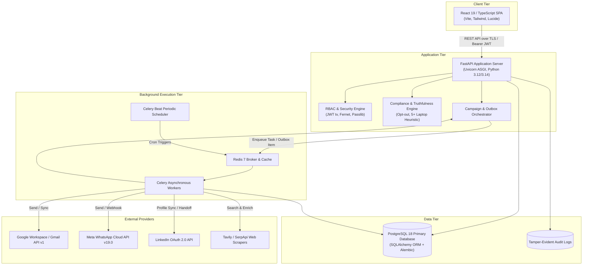
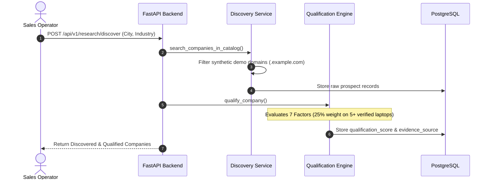
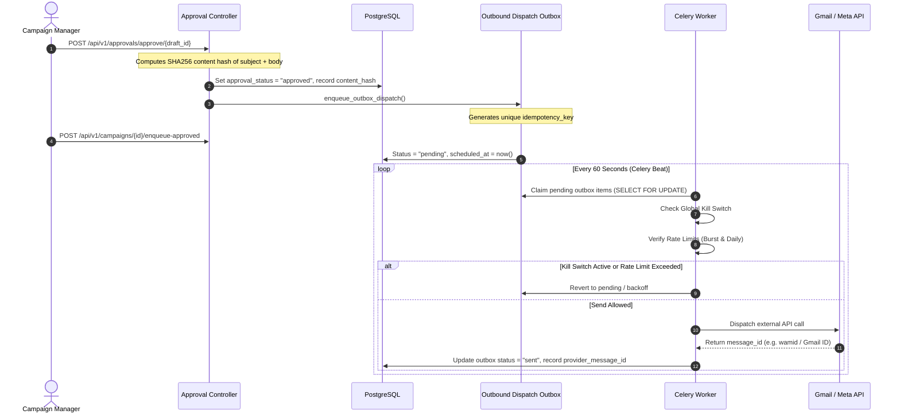

# ActTrident Architecture Specification

**Product**: ActTrident AI Outreach & Sales Automation  
**Audience**: Software Architects, Lead Engineers, DevOps, System Administrators  
**Revision**: 2.0 (Production Release)

---

## 1. System Overview

ActTrident is an enterprise-grade AI-powered sales outreach platform tailored for business discovery, qualification, and multi-channel engagement in Tier 2 and Tier 3 Indian technology hubs (Siliguri, Gangtok, Patna, Bhagalpur). The platform automates lead identification, enforces strict device-evidence qualification (5+ company-managed laptops), drafts hyper-personalized outreach, and requires human-in-the-loop governance prior to multi-channel delivery.

---

## 2. High-Level Architecture Diagram

---

## 3. Component Breakdown

### 3.1 Frontend Single Page Application (SPA)
- **Framework**: React 19, TypeScript, Vite.
- **Styling**: Tailwind CSS with custom ActTrident dark-mode cobalt palette (`#0f172a`, `#1e293b`, `#3b82f6`).
- **State & Data Fetching**: Centralized `api` client (`frontend/src/api/client.ts`) with automatic 401 JWT refresh token rotation, request queuing during refresh, and badge polling.
- **Key Modules**:
  1. `DashboardView`: Real-time funnel metrics, city breakdown, conversion rates.
  2. `DiscoveryView`: Targeted query generation across Siliguri, Gangtok, Patna, and Bhagalpur.
  3. `LeadsView`: Company directory with verified laptop counts and MCA/LinkedIn evidence sources.
  4. `ResearchView`: Deep company profiling and 7-factor qualification scoring.
  5. `CampaignsView`: Multi-channel campaign builder with lifecycle controls (Start, Pause, Stop).
  6. `ApprovalQueueView`: Human-in-the-loop review queue (Approve, Reject, Skip, Regenerate, Schedule).
  7. `EmailOutreachView`: Email draft composer with AI personalization and tone controls.
  8. `WhatsAppView`: WhatsApp message manager with template status and opt-in badges.
  9. `LinkedInView`: Manual handoff assistant and copy-paste clipboard workflow.
  10. `InboxView`: Inbound reply classification and sentiment categorization.
  11. `CrmPipelineView`: Visual 7-stage sales pipeline with streaming CSV export.
  12. `SettingsView`: Emergency kill switch, RBAC user provisioning, and suppression registry.

### 3.2 Backend Application Server
- **Framework**: FastAPI (Python ASGI) structured with clean architectural boundaries:
  - `app/api/endpoints/`: Thin controllers exposing versioned REST endpoints (`/api/v1/*`).
  - `app/services/`: Core business logic, qualification rules, and campaign workflows.
  - `app/models/`: Declarative SQLAlchemy models.
  - `app/schemas/`: Pydantic V2 request/response validation schemas.
  - `app/integrations/`: Channel adapters implementing standardized provider interfaces.
  - `app/core/`: Security, cryptographic operations, database session management, and configuration.

### 3.3 Background Worker & Task Queue
- **Broker**: Redis 7 on `redis://localhost:6379/0`.
- **Worker**: Celery process running `app.core.celery_app.celery_app`.
- **Beat Scheduler**: Manages periodic background jobs:
  - `process-transactional-outbox`: Every 60 seconds (flushes ready outbox items).
  - `sync-gmail-inbox-replies`: Every 300 seconds (polls Gmail for replies and bounces).
  - `nightly-lead-discovery`: Daily at 02:00 UTC (automated enrichment for target cities).
  - `process-scheduled-followups`: Every 600 seconds (checks due CRM reminders).
- **Dead Letter Queue (DLQ)**: Tasks exhausting max retries (3) are persisted to `DeadLetterTask` for operator inspection.

### 3.4 Data Layer
- **Primary Database**: PostgreSQL 18 in production, SQLite in local unit tests.
- **Migration Framework**: Alembic managing reversible migrations. Current head: `0007_phase7_campaign_enhancements`.
- **Integrity Constraints**: Foreign key cascading, unique constraints on user emails, company domains, outbox idempotency keys, and token hashes.

---

## 4. End-to-End Operational Flows

### 4.1 Discovery & Truthful Qualification Flow

### 4.2 Human-in-the-Loop Approval & Outbox Dispatch Flow

---

## 5. Reliability & Delivery Guarantees

1. **Exactly-Once Semantics**: The combination of `OutboundDispatchOutbox`, database transaction isolation, and SHA256 content hashes guarantees that network timeouts or worker crashes will not produce duplicate customer outreach.
2. **Safe Fallback**: In development or staging without live credentials, adapters automatically operate in `simulated` mode, recording mock receipts without making network requests.
3. **Suppression Enforcement**: The `handle_opt_out` routine immediately suppresses email, phone, or WhatsApp identifiers across all active campaigns and future discovery cycles.
