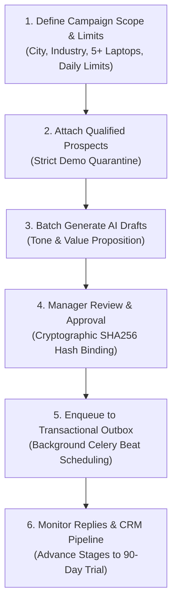

# ActTrident Campaign User Guide & Playbook

**Target Audience**: Campaign Managers, Sales Directors, Business Development Representatives (BDRs)  
**Primary Modules**: Campaigns, Approval Queue, CRM Pipeline, Analytics

---

## 1. Overview: The ActTrident Outreach Philosophy

ActTrident is built on three core operational tenets:
1. **Truthful Qualification**: We only engage prospects where verifiable evidence demonstrates an operational fit (tech sector, 5+ company-managed laptops, verified decision maker).
2. **Human-in-the-Loop Governance**: No AI-generated message is dispatched to a real customer without human review, content hashing, and explicit managerial sign-off.
3. **Multi-Channel Precision**: We orchestrate complementary touchpoints across Email, WhatsApp, and LinkedIn without overwhelming the recipient.

---

## 2. Step-by-Step Campaign Execution Lifecycle

---

## 3. Creating a Campaign

1. Log in to ActTrident and navigate to **Campaigns** from the left navigation bar.
2. Click **Create Campaign** in the upper right corner.
3. Complete the Campaign Definition Form:
   - **Campaign Name**: Give a descriptive name (e.g. `Siliguri Tech & Digital Hub - Q4 Evaluation`).
   - **Objective**: Summarize the campaign goal (e.g. `Invite software agencies with 5+ managed laptops to 90-day evaluation`).
   - **Target Geography**: Select your focus city (`Siliguri`, `Gangtok`, `Patna`, or `Bhagalpur`).
   - **Target Industry**: E.g. `Software Development`, `Digital Marketing`, `IT Services`.
   - **Minimum Device Threshold**: Default is `5`. Do not lower this below 5 without director approval.
   - **Minimum Qualification Score**: Default is `70.0` (out of 100).
   - **Permitted Channels**: Select checkboxes for `Email`, `WhatsApp`, and `LinkedIn`.
   - **Sending Limits**:
     - Daily Email Limit: `50` (recommended for cold outreach domain warm-up).
     - Daily WhatsApp Limit: `20` (complies with Meta Tier 1 initial rate limits).
   - **Sending Schedule Window**: Default: `09:00-18:00 IST Weekdays` (prevents dispatches outside local business hours).
4. Click **Create Campaign**. The campaign is saved in status `draft`.

---

## 4. Attaching Qualified Prospects

1. Open your created campaign and click **Add Recipients**.
2. Filter the verified prospect list by target city and qualification status (`High priority`).
3. Select the checkboxes next to companies with verified laptop evidence.
   > **Note on Demo Quarantine**: Any synthetic prospect with an `.example.com` domain or marked as a demo fixture is automatically blocked from live campaign insertion. Attempting to add demo records will trigger an explicit error banner.
4. Click **Add Selected Prospects**. The recipient status transitions to `pending`.

---

## 5. Batch Generating AI Outreach Drafts

1. With recipients attached, click **Generate Drafts**.
2. Select your desired tone:
   - `Friendly professional` (Default: warm, consultative, respectful of time).
   - `Direct executive` (Concise: 3-sentence proposition tailored to Managing Directors).
   - `Technical advisory` (Focuses on data leakage prevention, remote developer endpoints, and compliance).
3. Optional **Custom Guidance**: Add specific notes (e.g. `Highlight that we have active deployments in North Bengal and offer zero-touch onboarding`).
4. Click **Start Generation**. The AI engine processes each recipient, dynamically injecting verified facts (decision maker name, company location, documented laptop fleet size) into the draft.
5. Upon completion, drafts are automatically placed in the **Approval Queue**.

---

## 6. The Human-in-the-Loop Approval Queue

All generated communications require manager approval before they can be sent.

1. Navigate to **Approvals** from the sidebar.
2. Filter by your campaign name.
3. Review each message draft:
   - **Inspect Subject & Body**: Verify that the decision maker name and company details are accurate.
   - **Review Value Proposition**: Ensure the 90-day evaluation terms are clear.
4. Available Actions:
   - **Approve**: Signs off on the message and locks the text with a cryptographic SHA256 content hash. Approved messages cannot be accidentally modified.
   - **Edit**: Make manual copy adjustments. Editing increments the draft version number and requires re-approval.
   - **Regenerate**: Ask the AI to rewrite the message with a different tone or specific instructions.
   - **Schedule**: Pick an exact future date and time for delivery.
   - **Reject**: Decline the message with a documented reason (e.g. `Company was recently contacted via partner`).
   - **Bulk Actions**: Select multiple checkboxes to batch-approve or batch-reject.

---

## 7. Dispatching and Campaign Lifecycle Controls

Once drafts are approved, you have two options for execution:

### Option A: Autonomous Transactional Outbox (Recommended)
1. In the campaign view, click **Enqueue Approved Drafts**.
2. Drafts are safely transferred into the crash-safe `OutboundDispatchOutbox`.
3. The background **Celery Beat** worker dispatches messages according to your daily limits, respecting the 10/minute burst rate limit and business hours schedule.

### Option B: Immediate Dispatch
1. Click **Dispatch Now** to send the current approved batch synchronously.
2. Deliveries are processed immediately; the UI displays live counters for `sent`, `simulated`, and `failed`.

### Lifecycle Controls:
- **Pause Campaign**: Temporarily halts sending (e.g. during a company holiday). Outbox items remain queued.
- **Resume Campaign**: Re-activates sending.
- **Stop Campaign**: Permanently terminates the campaign and cancels all pending outbox entries.

---

## 8. Managing Replies & Advancing the CRM Pipeline

When a prospect responds:
1. Inbound messages are captured in the **Inbox** and auto-classified into sentiment categories:
   - **Positive Interest**: Prospect wants to learn more or asks about pricing.
   - **Meeting Request**: Prospect requests a demo or call.
   - **Technical Question**: Inquiry regarding platform capabilities.
   - **Opt-Out / Stop**: Prospect requests removal.
2. Open the lead in **CRM Pipeline**:
   - Drag or update status from `contacted` to `meeting_scheduled` or `trial_active`.
   - Log scheduled demo dates via **Add Meeting**.
   - Activate the complimentary trial via **Activate 90-Day Evaluation** (recording approved device count).
3. If the prospect replies `STOP` or asks to unsubscribe:
   - Click **Record Opt-Out**. The system immediately suppresses the prospect across all channels.
