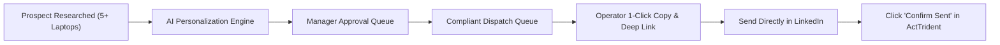

# ActTrident AI Outreach Platform — Customer Onboarding & Channel Connection Guide

This guide is designed for sales directors, operations heads, and system administrators who want to connect their communication channels (**Gmail/Email**, **WhatsApp**, and **LinkedIn**) to ActTrident and begin live B2B outreach safely and compliantly.

---

## Table of Contents
1. [Overview & Core Compliance Philosophy](#1-overview--core-compliance-philosophy)
2. [Step-by-Step: Connecting Email Outreach](#2-step-by-step-connecting-email-outreach)
   - [Option A: Google Workspace / Gmail (OAuth 2.0)](#option-a-google-workspace--gmail-oauth-20-recommended)
   - [Option B: Standard SMTP & Custom Mailboxes](#option-b-standard-smtp--custom-mailboxes)
   - [Email Verification & Daily Quota Safeguards](#email-verification--daily-quota-safeguards)
3. [Step-by-Step: Connecting Meta WhatsApp Cloud API](#3-step-by-step-connecting-meta-whatsapp-cloud-api)
   - [Why Official Meta Cloud API?](#why-official-meta-cloud-api)
   - [Creating the Meta Business App & System User](#creating-the-meta-business-app--system-user)
   - [Registering the Required Message Template](#registering-the-required-message-template)
   - [Configuring the Webhook](#configuring-the-webhook)
   - [Documenting Contact Consent](#documenting-contact-consent)
4. [Step-by-Step: Connecting LinkedIn](#4-step-by-step-connecting-linkedin)
   - [Safe Architecture: Why No Unofficial Scraping?](#safe-architecture-why-no-unofficial-scraping)
   - [Optional Official LinkedIn OAuth 2.0](#optional-official-linkedin-oauth-20)
   - [The Compliant Operator Handoff Workflow](#the-compliant-operator-handoff-workflow)
5. [Running Your First Live Outreach Campaign](#5-running-your-first-live-outreach-campaign)
6. [Emergency Controls & Troubleshooting FAQ](#6-emergency-controls--troubleshooting-faq)

---

## 1. Overview & Core Compliance Philosophy

ActTrident is built for targeted B2B technology outreach in regional clusters (Siliguri, Gangtok, Patna, Bhagalpur). Our target profile is verified tech, IT, and software firms managing **5 or more company laptops/workstations**.

### Our 5 Core Safety Pillars:
1. **Mandatory Human-in-the-Loop**: No message is ever dispatched automatically without human review and approval by an authorized manager or administrator.
2. **Cryptographic Content Hash Binding**: When a manager approves a draft, an immutable SHA-256 hash of the exact subject and body is locked into the approval record. If anyone alters even one word, the dispatch engine detects the hash mismatch and automatically invalidates the approval.
3. **No Fabricated Data**: ActTrident never fakes delivery receipts, message IDs, or analytics. Simulated messages are clearly flagged as simulated.
4. **Strict Opt-Out & Suppression Lists**: Any recipient who replies with "STOP", "Unsubscribe", or clicks an opt-out link is immediately added to the suppression list across all channels.
5. **Channel Account Safety**: We refuse to use headless browser scraping or cookie theft for WhatsApp or LinkedIn, protecting your business accounts from permanent platform bans.

---

## 2. Step-by-Step: Connecting Email Outreach

ActTrident offers two enterprise options for email sending: **Google Workspace OAuth 2.0** (least-privilege REST API) and **Standard SMTP** (compatible with Microsoft 365, Zoho, Amazon SES, or custom servers).

### Option A: Google Workspace / Gmail (OAuth 2.0) [Recommended]

This method allows ActTrident to send emails directly through your corporate Google Workspace mailbox with automatic bounce tracking and two-way reply synchronization.

#### Step 1: Open Google Cloud Console
1. Go to [https://console.cloud.google.com/](https://console.cloud.google.com/).
2. Log in with your organization's administrative Google Workspace account.
3. Click **Select a project** at the top bar and click **New Project**. Name it `ActTrident Outreach` and click **Create**.

#### Step 2: Enable the Gmail API
1. In the left navigation sidebar, go to **APIs & Services** > **Library**.
2. Search for `Gmail API`.
3. Click on **Gmail API** and click **Enable**.

#### Step 3: Configure the OAuth Consent Screen
1. Go to **APIs & Services** > **OAuth consent screen**.
2. Select **User Type**:
   - If your entire team is in Google Workspace: choose **Internal** (only people inside your organization can sign in).
   - If you are using standard Google accounts: choose **External** (add your test user emails).
3. Fill in the required application details:
   - **App name**: `ActTrident Sales Outreach`
   - **User support email**: Your admin email address
   - **Developer contact information**: Your technical email address
4. Click **Save and Continue**.
5. On the **Scopes** page, click **Add or Remove Scopes** and select:
   - `https://www.googleapis.com/auth/gmail.send` (Send messages on your behalf)
   - `https://www.googleapis.com/auth/gmail.readonly` (Read resources and identify replies)
   - `https://www.googleapis.com/auth/userinfo.email` (See your primary Google account email address)
6. Click **Update** > **Save and Continue**.

#### Step 4: Create OAuth 2.0 Client ID Credentials
1. Go to **APIs & Services** > **Credentials**.
2. Click **+ Create Credentials** > **OAuth client ID**.
3. Under **Application type**, select **Web application**.
4. **Name**: `ActTrident Web Client`.
5. Under **Authorized redirect URIs**, click **+ Add URI** and enter:
   - For Local Testing: `http://localhost:8000/api/v1/integrations/gmail/callback`
   - For Production: `https://your-domain.com/api/v1/integrations/gmail/callback`
6. Click **Create**.
7. Google will show you your **Client ID** (e.g. `123456789-abc.apps.googleusercontent.com`) and **Client Secret**. Keep these secure.

#### Step 5: Save Credentials in ActTrident Backend
Add the credentials to your backend `.env` file (or host environment variables):
```ini
GMAIL_CLIENT_ID=123456789-abc.apps.googleusercontent.com
GMAIL_CLIENT_SECRET=GOCSPX-yourClientSecretHere
GMAIL_REDIRECT_URI=http://localhost:8000/api/v1/integrations/gmail/callback
```
Restart your backend service if needed.

#### Step 6: Authorize the Mailbox via the UI
1. Log in to the ActTrident UI as an Administrator.
2. In the left sidebar, click **Integrations**.
3. Locate the **Gmail API (Google OAuth 2.0)** card.
4. Click **Connect Gmail (OAuth 2.0)**.
5. A Google authorization popup will open. Select your corporate mailbox and grant sending and reply-reading permissions.
6. Upon approval, you will be redirected back to ActTrident.
7. The status badge will change from `DISCONNECTED` to `CONNECTED` (Active Mode: `gmail_api`).

---

### Option B: Standard SMTP & Custom Mailboxes

If you use Microsoft 365, Zoho Mail, SendGrid, or custom hosting:

#### Step 1: Obtain Your Mail Provider's SMTP Settings
Common provider settings:
- **Microsoft 365 / Outlook**: Host `smtp.office365.com`, Port `587`, STARTTLS enabled.
- **Zoho Mail**: Host `smtp.zoho.com`, Port `587` (or `465`), SSL/TLS enabled.
- **Gmail (App Password)**: Host `smtp.gmail.com`, Port `587`.

> [!NOTE]
> If your email account has Multi-Factor Authentication (MFA) enabled, you must generate a dedicated **App Password** from your account security portal instead of using your primary password.

#### Step 2: Configure in ActTrident UI
1. Go to **Integrations** in the ActTrident navigation.
2. Under **Email Delivery (SMTP / Gmail)**:
   - Select **Provider Type**: `Configurable SMTP (Gmail / Custom)`
   - Enter **SMTP Host & Port**: e.g. `smtp.gmail.com` and `587`
   - Enter **Username / From Address**: e.g. `outreach@acttrident.ai`
   - Enter **App Password / Secret**: Your generated 16-character app password
3. Click **Save Email Config**.

---

### Email Verification & Daily Quota Safeguards

To protect your domain reputation, ActTrident automatically enforces:
- **Daily Sending Ceilings**: Default max 50 emails per day (configurable via `DEFAULT_DAILY_EMAIL_LIMIT` in `.env`).
- **Per-Minute Throttle**: Max 30 emails per minute to prevent provider rate limiting.
- **Mandatory Opt-Out Footer**: Every sent email includes a one-click unsubscribe link and physical company address.

---

## 3. Step-by-Step: Connecting Meta WhatsApp Cloud API

ActTrident integrates exclusively with the **Official Meta WhatsApp Business Cloud API**. This ensures complete compliance with Meta's Commerce and Business Policies and prevents your corporate WhatsApp numbers from being banned.

### Creating the Meta Business App & System User

#### Step 1: Set Up Meta for Developers
1. Log in to [https://developers.facebook.com/](https://developers.facebook.com/) with your Meta account.
2. Click **My Apps** > **Create App**.
3. Select **Other** as the use case > click **Next**.
4. Select **Business** as the app type > click **Next**.
5. Name your app `ActTrident WhatsApp Connector` and select your **Meta Business Account**. Click **Create App**.

#### Step 2: Add WhatsApp to Your App
1. On the app dashboard, find **WhatsApp** and click **Set up**.
2. You will be taken to the WhatsApp Getting Started page.

#### Step 3: Generate a Permanent System User Access Token
> [!IMPORTANT]
> The temporary token provided on the "Getting Started" page expires in 24 hours. For production outreach, you must generate a permanent System User token.

1. Go to [https://business.facebook.com/settings](https://business.facebook.com/settings).
2. Under **Users**, click **System Users**.
3. Click **Add** > Name it `ActTrident System User` > Select Role: **Admin**.
4. Click **Assign Assets** > Select **Apps** > Select your `ActTrident WhatsApp Connector` app > Grant **Full Control** > Click **Save Changes**.
5. Click **Generate New Token**.
6. Select your app from the dropdown.
7. Under permissions, select:
   - `whatsapp_business_messaging`
   - `whatsapp_business_management`
8. Set Token Expiration to **Never** (Permanent).
9. Click **Generate Token** and copy the resulting string (`EAAB...`).

#### Step 4: Retrieve IDs
In your Meta App Dashboard under **WhatsApp** > **API Setup**, copy:
- **Phone number ID**: A 15-digit number (e.g. `109876543210987`).
- **WhatsApp Business Account ID**: A 15-digit number (e.g. `987654321098765`).

#### Step 5: Save in ActTrident UI
1. In the ActTrident navigation, go to **Integrations**.
2. Scroll to **Meta WhatsApp Cloud API**.
3. Enter your **Permanent Access Token**, **Phone Number ID**, and **WhatsApp Business Account ID**.
4. Click **Save Meta WhatsApp API**.

---

### Registering the Required Message Template

Meta requires all outbound business-initiated messages to use pre-approved templates.

1. In your Meta Business Manager, go to **WhatsApp Manager** > **Message Templates**.
2. Click **Create Template**:
   - **Category**: `Utility`
   - **Name**: `acttrident_intro_utility_v1`
   - **Language**: `English (US)` or `en`
3. Enter the content:
   - **Header** (Optional): `ActTrident Technology Evaluation`
   - **Body**:
     ```text
     Hello {{1}}, we noticed your organization manages active digital operations in {{2}}. ActTrident provides specialized workspace security for teams with 5+ laptops. Would you be open to a brief 15-minute product demonstration?
     ```
   - **Footer**: `Reply STOP to unsubscribe`
   - **Buttons** (Optional): Quick Reply `Interested` or `Not Now`.
4. Click **Submit for Review**. Meta's automated approval system typically approves Utility templates within 2 to 10 minutes.

---

### Configuring the Webhook

To receive delivery receipts (`sent`, `delivered`, `read`) and prospect replies:
1. In your Meta App Dashboard, go to **WhatsApp** > **Configuration**.
2. Under **Webhook**, click **Edit**:
   - **Callback URL**: `https://your-domain.com/api/v1/whatsapp/webhook`
   - **Verify Token**: Must match your `META_WA_VERIFY_TOKEN` configured in your backend `.env` (e.g. `ActTridentVerifySecureToken2026!`).
3. Click **Verify and Save**.
4. Under **Webhook fields**, click **Manage** and subscribe to:
   - `messages`

---

### Documenting Contact Consent

Meta and Indian telecom regulations require documented opt-in before sending WhatsApp messages. ActTrident enforces this at the code level:
- In the CRM, every contact has a **Consent Record**.
- You can record consent via the UI or API by noting the source (e.g. "MCA Corporate Filing", "Opt-in form at trade exhibition", or "Inbound enquiry").
- If a contact replies with "STOP", ActTrident immediately revokes their consent and adds their phone number to the suppression list.

---

## 4. Step-by-Step: Connecting LinkedIn

LinkedIn has strict terms regarding automated messaging. Unofficial extensions and headless browser scrapers (which steal your `li_at` cookie) routinely cause immediate and permanent account bans.

ActTrident protects your company profile through a **100% Compliant Operator Handoff Architecture**.

### The Compliant Operator Handoff Workflow



1. **Character Constraint Enforced**: Connection notes are strictly limited to 295 characters (under LinkedIn's 300 character limit). InMails and Direct Messages are capped at 1,900 characters.
2. **Approval Record Created**: A sales manager reviews the message and signs off with cryptographic hash locking.
3. **One-Click Operator Action**:
   - The sales representative navigates to **Operator Dispatch** in ActTrident.
   - The UI displays the recipient's verified LinkedIn profile link, the exact approved text, and a **Copy to Clipboard** button.
   - The representative clicks the link, pastes the note into LinkedIn, sends it, and clicks **Confirm Sent** in ActTrident.
4. **CRM Synchronized**: ActTrident updates the lead stage to `contacted` and logs the audit event.

### Optional Official LinkedIn OAuth 2.0

If your organization has an approved LinkedIn Developer Application:
1. In the LinkedIn Developer Portal, configure OAuth 2.0 with redirect URI:
   `https://your-domain.com/api/v1/integrations/linkedin/callback`
2. Add `LINKEDIN_CLIENT_ID` and `LINKEDIN_CLIENT_SECRET` to backend `.env`.
3. In ActTrident UI > **Integrations**, click **Connect LinkedIn (OAuth 2.0)** to link your profile for authenticated identity.

---

## 5. Running Your First Live Outreach Campaign

Here is the step-by-step workflow for launching your first compliant campaign:

### Step 1: Discover and Verify Target Prospects
1. Navigate to **Research & Discovery** in ActTrident.
2. Search for companies in **Siliguri**, **Gangtok**, **Patna**, or **Bhagalpur**.
3. Inspect the verified laptop fleet evidence:
   - Ensure the company has **5+ verified laptops** documented via MCA filings, careers pages, or office audits.
4. Check the 7-Factor Lead Qualification Score (aim for scores of 75+).

### Step 2: Create a Campaign
1. Go to **Campaigns** > **Create Campaign**.
2. Give the campaign a descriptive name (e.g., `Siliguri Tech Parks Q4 Outreach`).
3. Set your target filters:
   - Target City: `Siliguri`
   - Target Industry: `Software Development`
   - Minimum Devices: `5`
   - Daily Email Limit: `25`
   - Schedule: `09:00 - 18:00 IST Weekdays`
4. Attach your verified target companies to the campaign.

### Step 3: Generate AI Drafts
1. Inside the campaign, click **Generate Personalized Drafts**.
2. Choose your preferred tone (e.g. `Friendly professional` or `Formal intro`).
3. ActTrident's AI will craft tailored messages highlighting local context and the 90-day complimentary evaluation program.

### Step 4: Human Review & Approval
1. Navigate to the **Approval Queue**.
2. Inspect each generated draft. You can:
   - **Approve**: Locks the draft and signs it with a SHA-256 content hash.
   - **Edit**: Adjust the wording (saving an edit resets approval to ensure safety).
   - **Reject**: Discards the draft and notes the reason.
3. Approved drafts are placed into the **Transactional Outbox**.

### Step 5: Dispatching
1. The background outbox worker processes pending messages in accordance with rate limits and business hours (09:00 - 18:00 IST).
2. If credentials are fully configured, emails are dispatched via the Gmail API or SMTP server.
3. If credentials are not configured, ActTrident safely simulates dispatch locally so you can practice the workflow without sending real messages.

---

## 6. Emergency Controls & Troubleshooting FAQ

### Global Emergency Kill Switch
If you need to halt all outbound communications immediately across all channels:
1. In the top navigation bar, click the **Stop All Outbound (Kill Switch)** toggle.
2. Enter an administrative reason (e.g., "Reviewing copy adjustments").
3. **Outcome**: All pending outbox items are instantly blocked. Background workers will refuse to dispatch any messages until an administrator explicitly deactivates the kill switch.

### Common Questions & Troubleshooting

| Issue | Cause | Solution |
| :--- | :--- | :--- |
| **Gmail OAuth says "Redirect URI Mismatch"** | The URL in Google Cloud Console doesn't match your actual server address. | Add `http://localhost:8000/api/v1/integrations/gmail/callback` (or your domain) to Authorized redirect URIs in Google Cloud Console. |
| **Email fails with "Draft modified after approval"** | Someone edited the draft text after the manager approved it. | Re-open the draft in the Approval Queue and have the manager approve the updated version. |
| **WhatsApp error "Template Not Approved"** | The template name in ActTrident hasn't been approved in Meta Business Manager. | Submit the template in Meta WhatsApp Manager under Category: Utility and wait for approval. |
| **Daily limit reached warning** | The system reached its configured safety ceiling (e.g. 50 emails/day). | Messages are held safely in the queue until tomorrow, or an admin can increase `DEFAULT_DAILY_EMAIL_LIMIT` in `.env`. |
| **Suppression list notice** | The recipient previously opted out or bounced. | ActTrident permanently respects opt-outs. Contact an administrator only if the recipient explicitly rescinded their opt-out in writing. |

---

*ActTrident AI Sales Outreach & Workspace Security Platform — Engineered for Compliance, Verification, and High-Conversion B2B Outreach.*
