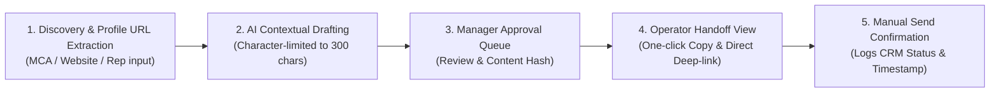

# LinkedIn Integration: Capabilities, Platform Limitations & Operator Handoff

**Component**: `backend/app/services/linkedin_service.py`, `frontend/src/views/LinkedInView.tsx`  
**Compliance Standard**: LinkedIn User Agreement Section 8.2 (Prohibited Conduct) & LinkedIn Developer API Terms of Service

---

## 1. Executive Summary: Why Full LinkedIn Messaging Automation is Prohibited

A frequent point of confusion in sales automation platforms is whether direct LinkedIn messaging (InMails, private direct messages, automated connection invitations) can be fully executed via an unattended backend background task.

**Under LinkedIn's official Developer Policy and API terms, unattended direct messaging is strictly restricted.** Attempting to bypass these limitations via headless browser automation (Puppeteer/Playwright), session cookie extraction (`li_at`), or third-party scraping extensions results in **permanent account bans, domain blacklisting, and potential legal action under the Computer Fraud and Abuse Act (CFAA) and equivalent Indian IT Act provisions**.

ActTrident implements a **fully compliant, semi-automated operator handoff architecture** that eliminates risk while maximizing sales representative productivity.

---

## 2. Official LinkedIn API Capabilities vs. Restrictions

| Feature | Official LinkedIn Public API Status | ActTrident Compliant Architecture |
|---|---|---|
| **OAuth 2.0 User Sign-In** | **Supported** (`openid`, `profile`, `email`) | Permitted for rep authentication and profile association. |
| **Share on LinkedIn** | **Supported** (`w_member_social`) | Allows publishing approved company posts or articles. |
| **1-on-1 Private InMail / Messaging** | **RESTRICTED** (Requires enterprise LinkedIn Sales Navigator Partner contract) | **AI Message Drafting + One-Click Clipboard Copy + Operator Handoff Workflow**. |
| **Automated Connection Requests** | **PROHIBITED** | Rep reviews draft, clicks profile link, pastes note in LinkedIn UI. |
| **Profile Scraping via Headless Browsers** | **STRICTLY PROHIBITED** | Public MCA corporate filings, official company websites, and user-provided URLs only. |
| **Browser Cookie / Session Scraping** | **STRICTLY PROHIBITED** | **Never implemented**. ActTrident does not collect, store, or accept `li_at` cookies. |

---

## 3. ActTrident Compliant Operator Handoff Architecture

To balance enterprise compliance with operational speed, ActTrident uses a 4-step Human-Assisted Outreach Pipeline:

### Step 1: Profile Evidence Validation
During prospect discovery, ActTrident captures verified LinkedIn company URLs (`https://linkedin.com/company/...`) and decision maker profile handles from public MCA filings or official corporate websites.

### Step 2: Context-Aware Message Drafting
ActTrident generates tailored LinkedIn outreach tailored to LinkedIn's specific message formats:
- **Connection Request Note**: Enforces a strict **300-character ceiling** (maximum allowed by LinkedIn for invitation notes). Emphasizes local context (e.g. Siliguri/Gangtok tech presence) and the 90-day laptop protection evaluation.
- **InMail / Direct Message**: Structured for prospects who already share a 1st-degree connection or open profile. Focuses on endpoint compliance and executive peace of mind.

### Step 3: Human Review & Approval
Drafts are queued in `ApprovalQueueView`. Managers review the message copy for professional tone, device evidence accuracy, and compliance before signing off.

### Step 4: The Operator Handoff Interface (`LinkedInView.tsx`)
In the dedicated LinkedIn interface:
1. The sales representative clicks **"Copy Message"** (automatically copies sanitized text to the system clipboard).
2. The representative clicks **"Open LinkedIn Profile"** (opens the prospect's LinkedIn profile in a new browser tab with active user session).
3. The representative pastes the text into the LinkedIn connection or message dialog and clicks Send.
4. The representative returns to ActTrident and clicks **"Mark as Sent"**, which:
   - Updates the draft status to `sent_manually`.
   - Records an immutable audit log entry.
   - Advances the lead in the CRM pipeline to `contacted`.
   - Schedules the Day-3 follow-up reminder.

---

## 4. Risks of Non-Compliant Tools (Why ActTrident Rejects Unofficial Scraping)

1. **LinkedIn Detection Algorithms**: LinkedIn employs sophisticated behavioral heuristics (typing rhythm, mouse movements, rapid request cadences, headless Chrome fingerprinting). Unofficial scrapers and Chrome extensions are routinely detected within 24–72 hours.
2. **Account Termination**: LinkedIn permanently restricts the personal profile of the sales representative or founder, destroying established business networks.
3. **Enterprise Legal Risk**: Corporate domains associated with aggressive scraping are subject to cease-and-desist notifications and domain-level blocking.

By strictly adhering to the Operator Handoff model, ActTrident guarantees **100% account safety**, full legal compliance, and authentic human relationships.
