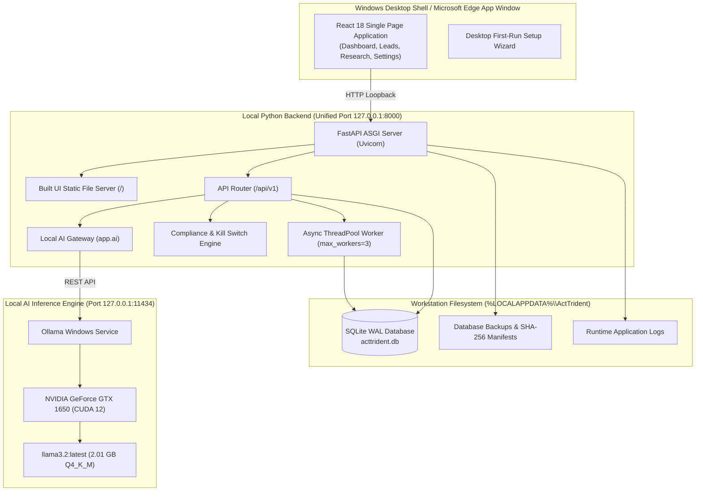

# ACTTRIDENT — LOCAL-FIRST DESKTOP ARCHITECTURE SPECIFICATION

**Document ID:** `ACT-ARCH-LOCAL-2026-V1`  
**Classification:** Core System Architecture  

---

## 1. Architectural Philosophy

ActTrident is an enterprise-grade AI Sales Outreach and Research platform redesigned from the ground up to run as a **self-contained, private, local-first Windows desktop application**.

### Core Tenets:
1. **Zero Mandatory Cloud Dependencies:** The application requires no cloud server (Railway, Render, AWS), no cloud PostgreSQL database, and no paid Anthropic / Claude subscription.
2. **GPU-Accelerated Local Inference:** Natural language synthesis, 7-factor fleet qualification rationale, and multi-channel copywriting execute directly on the local GPU via Ollama (`llama3.2:latest`, ~48 tokens/sec).
3. **Local Persistent Storage:** All business data, prospects, campaigns, drafts, and audit logs persist in `%LOCALAPPDATA%\ActTrident\data\acttrident.db` in SQLite WAL mode.
4. **Unified Single-Port Web Service:** The FastAPI backend serves both the REST API (`/api/v1`) and the pre-compiled React 18 production bundle (`/`) from a single loopback socket (`127.0.0.1:8000`).
5. **Fail-Closed Live Outreach Safety:** Live sending is strictly disabled by default (`LIVE_SEND_ENABLED=false`). External dispatches require explicit operator credentials and per-message human approval.

---

## 2. Component Topology

