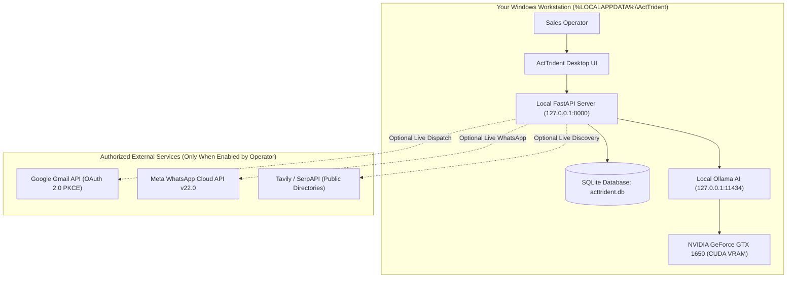

# ACTTRIDENT — PRIVACY ARCHITECTURE & DATA FLOW SPECIFICATION

**Document ID:** `ACT-PRIVACY-2026-V1`  
**Classification:** Public Architecture & Security Documentation  
**Compliance Standard:** Local-First Principle, India DPDP Act 2023, TRAI TCCCPR 2018  

---

## 1. Local-First Privacy Boundary

ActTrident is architected around a strict local-first data boundary. By default, **no customer data, prospect research, CRM notes, or AI prompts leave your personal Windows workstation**.

---

## 2. Detailed Data Transmission Disclosure

| Category | Storage / Processing Location | Leaves Computer? | Destination / Provider | Purpose |
| :--- | :--- | :---: | :--- | :--- |
| **Prospect Profiles & CRM Leads** | `%LOCALAPPDATA%\ActTrident\data\acttrident.db` | **NO** | Strictly Local | Pipeline tracking, contact notes |
| **AI Inference Prompts & Dossiers** | Local Ollama (`llama3.2:latest`) | **NO** | Local GPU / VRAM | Deep research synthesis & copywriting |
| **Authentication & Operator Credentials** | Local SQLite (`users`, `token_version`) | **NO** | Strictly Local | Workstation access control |
| **Tamper-Evident Security Audit Logs** | Local SQLite (`audit_logs`) | **NO** | Strictly Local | Accountability & action ledger |
| **Internet Web Research Queries** | Optional External Search | **YES** | Tavily / SerpAPI / OSM | Public business lookup (domain/city only) |
| **Approved Outbound Email** | Optional Live Dispatch | **YES** | Google Gmail REST API | Delivery of operator-approved emails |
| **Approved Outbound WhatsApp** | Optional Live Dispatch | **YES** | Meta Graph API v22.0 | Delivery of operator-approved templates |
| **LinkedIn Outbound Outreach** | Manual Operator Handoff | **NO** | Operator Browser Tab | Deep link only; ActTrident transmits nothing |

---

## 3. Data Deletion & India DPDP Act 2023 Compliance

1. **Right to Erasure (DPDP Act 2023 Section 12):** Any contact or company record can be erased instantly via the CRM or public opt-out endpoint (`POST /api/v1/crm/public/opt-out`). Erasure purges contact identifiers and logs the identifier in the irreversible suppression ledger.
2. **Local Data Purge:** To delete all local data, stop ActTrident and delete the `%LOCALAPPDATA%\ActTrident` folder. No remote telemetry or cloud copies exist.
3. **Point-In-Time Backups:** Automated backups are stored encrypted in `%LOCALAPPDATA%\ActTrident\backups\` with SHA-256 manifests.
